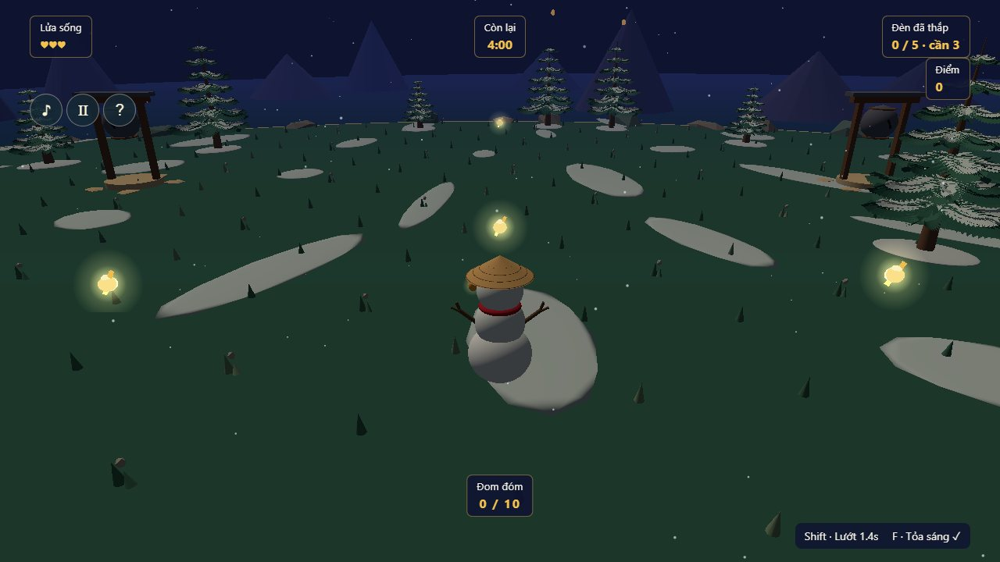

# Đảo Đèn Lồng · Bình minh v1.0.0

[**Tải bản chơi**](https://github.com/bato-bato/K5-L3A-DAY12-Tong-Thien-Bao-2A202603461-AI-SDLC-Dao-Den-Long/releases/tag/v1.0.0) · [Video demo](docs/demo/demo.mp4) · [Retro bốn phase](docs/retro.md)



Dẫn Mây qua ba hòn đảo, gom đom đóm, châm dầu và giữ 3/5, 4/6 rồi 5/7 đèn sáng đến bình minh. Bóng Mực có thể hút đèn dưới 30 dầu. Thắp mới cần 10 đom đóm, thắp lại cần 5. Mỗi con dùng để châm hồi 10 dầu. Túi tăng hai chỗ mỗi lần thắp, tối đa 20.

## Chơi

Cần trình duyệt hỗ trợ WebGL 2, bật tăng tốc phần cứng. Bản ZIP có thể chơi offline trên Windows, Linux và macOS. Giải nén rồi mở **docs/demo/choi-ngay.html**. Với bảng điểm dùng chung giữa game và CLI, cài Node.js 22.12+ và chạy từ thư mục repo hoặc thư mục giải nén:

```sh
node scripts/run.js
```

Mở **http://127.0.0.1:5173**. Máy chủ chỉ lắng nghe trên máy cá nhân. Khi phát triển từ repo sạch, chạy `npm ci`, `npm run build`, rồi `npm run dev`.

| Hành động | Phím mặc định |
|---|---|
| Di chuyển / xoay camera | WASD hoặc mũi tên / kéo chuột ngang |
| Nhảy / lướt | Space / Shift |
| Nạp đèn, châm dầu / tỏa sáng | E / F |
| Tạm dừng | P hoặc Esc |

Trong **Cài đặt**, chọn hành động rồi nhấn phím mới. Game báo phím trùng và lưu thay đổi. Có chữ lớn, giảm chuyển động và bảng màu dễ phân biệt. Mũi tên báo hướng Bóng mới xuất hiện. HUD báo gió, 10 giây cuối và ID đèn yếu.

Nạp một con được 5 điểm, thắp lần đầu thêm 100, thắp lại thêm 40. Tỏa sáng trúng Bóng được 5 điểm, hoặc 15 khi Bóng đang hút. Khi thắng, mỗi đèn sáng cho 50 cộng phần nguyên số dầu, mỗi lửa còn lại cho 50. Sau khi thua hoặc thắng cả ba Đêm, nhập tên để lưu tổng điểm các Đêm đã thắng.

## Bảng điểm

Lệnh dưới xuất top 10 từ cùng tệp mà máy chủ sử dụng, mặc định ở `~/.dao-den-long/leaderboard.json`. Biến môi trường `LANTERN_LEADERBOARD` cho phép chọn đường dẫn khác. Khi mở HTML trực tiếp hoặc dùng hosting tĩnh, điểm thuộc bộ nhớ cục bộ của trình duyệt. Dùng nút **Xuất JSON** trên màn hình Bảng xếp hạng cho cách chơi đó.

```sh
node scripts/run.js --export-leaderboard out.json
```

## Kiểm chứng

Chạy các lệnh sau tại gốc repo sau `npm ci`. Benchmark cần Chrome desktop, phiên đồ họa và GPU WebGL 2. Có thể đặt `BROWSER_CHANNEL=msedge` nếu dùng Edge. Để cửa sổ benchmark ở phía trước trong khi đo.

```sh
npm run verify
node scripts/headless.js --seed 12 --night 1 --ticks 120 --scenario scenarios/dawn.json --out dawn.jsonl
node scripts/bench.js --seed 42 --duration 30 --out bench.json
node --jitless --max-semi-space-size=1 scripts/soak.js --seed 7 --nights 10 --out soak.json
node scripts/check-release.js
```

Benchmark dùng khung vẽ 1280×720, camera bán kính 30 m, độ cao 15 m, một vòng 15 s. Chrome được khởi động với cờ tắt GPU vsync và giới hạn FPS. Driver hoặc compositor vẫn có thể giới hạn tốc độ trình bày. Mốc đầu là callback của khung cảnh đầu tiên. Sau 3 s làm nóng, lấy khoảng cách thời gian giữa các khung bằng requestAnimationFrame. P95 dùng nearest rank. WebGL chạy qua nhiều tiến trình trình duyệt và GPU dùng chung nên RSS riêng của game là null. Scene dùng Night 1, nhân vật chuẩn giản lược và tắt tuyết rơi.

Soak chạy chung một tiến trình Node, seed đầu 7 rồi tăng mỗi Đêm, thay hướng sau 30 tick. Tắt JIT và giới hạn vùng cấp phát ngắn hạn của V8 ở lệnh soak để hạn chế tăng RSS do biên dịch và garbage collection. Báo cáo lấy RSS thật trước khi chạy input và sau reset cuối.

[Contract v1.3](game.contract.json) · [Số đo benchmark](bench.json) · [Kết quả soak](soak.json) · [Bằng chứng kiểm thử](docs/proof/phase4/) · [Changelog](CHANGELOG.md) · [Nguồn asset](CREDITS.md)

## Sáng tạo của tôi

Mây là người tuyết đội nón lá có đèn nhỏ. Cành thông phủ tuyết, tuyết rơi quanh camera, ánh chớp nối tay với đèn khi nạp. Các hiệu ứng được vẽ ở renderer. Bằng chứng giao diện có trong [bộ ảnh mùa đông](docs/proof/winter/).

# Day 12 — AI SDLC: Đảo Đèn Lồng

> **Cá nhân** (1 người / 1 MSSV) · Áp dụng SDLC cùng AI để xây một **game 3D** qua **4 phase**, từ yêu cầu ban đầu tới bản phát hành.
> **Lab board + trợ giảng:** **[Đảo Đèn Lồng Lab](https://claude.ai/artifact/Q1RYyv1dxjUczzCbd2ZnoW)**

---

## Tài liệu của lab

| File | Nội dung |
|---|---|
| [GUIDE.md](GUIDE.md) | Hướng dẫn làm lab: vòng làm việc mỗi phase, harness, kiểm chứng, token |
| [CHECKPOINTS.md](CHECKPOINTS.md) | Các mốc tự kiểm tra từ chuẩn bị đến nộp bài |
| [SUBMISSION.md](SUBMISSION.md) | Đặt tên repo, hạn nộp, tag, Release, video, checklist |
| [RULES.md](RULES.md) | Quy định: AI, trung thực về bằng chứng, bản quyền, bảo mật |
| [RUBRIC.md](RUBRIC.md) | Thang điểm chi tiết |

## Lab board

Yêu cầu dự án được phát hành tại **[Đảo Đèn Lồng Lab](https://claude.ai/artifact/Q1RYyv1dxjUczzCbd2ZnoW)**. Mỗi phase là một tab (tab chưa phát hành bị khóa), mỗi tab có trợ giảng AI riêng chỉ trả lời trong phạm vi phase đó. Trợ giảng cần đăng nhập claude.ai và dùng lượt Claude của bạn.

## Dự án

**Đảo Đèn Lồng**: game 3D góc nhìn thứ ba. Mây, người giữ đèn nhỏ tuổi, gom đom đóm để thắp lại các Đèn Lồng Lớn và né Bóng Mực trong sương đen.

- Không ràng buộc công nghệ; chạy được trên macOS hoặc Linux.
- Tuân theo **Test Contract** (chế độ headless) để được chấm tự động và so sánh với nhau.

| Phase | Bạn nhận | Nộp |
|---|---|---|
| 1 | **PRD-0** (mô tả tổng quát) + Test Contract | tag `phase-1` |
| 2 | **Ticket-02**, phát hành khi Phase 1 kết thúc | tag `phase-2` |
| 3 | **Ticket-03**, phát hành khi Phase 2 kết thúc | tag `phase-3` |
| 4 | **Ticket-04**, phát hành khi Phase 3 kết thúc | tag `phase-4` + Release `v1.0.0` |

Yêu cầu sẽ được bổ sung và có thể thay đổi giữa các phase, giống dự án thật.

### Lịch 4 giờ

Bài lab kéo dài **4 giờ**. Phase 1 và 2 khoảng **1 giờ**, Phase 3 khoảng **30 phút**, Phase 4 khoảng **1 giờ 30 phút**. Mỗi phase phát hành đúng mốc giờ. Phase mới xuất hiện trên lab board khi tới mốc.

| Mốc | Sự kiện | Hạn tag |
|---|---|---|
| 0h | Phát hành **Phase 1** (PRD-0), gồm cả phần chuẩn bị | `phase-1` trước mốc 1h |
| 1h | Phát hành **Phase 2** | `phase-2` trước mốc 2h |
| 2h | Phát hành **Phase 3** | `phase-3` trước mốc 2h30 |
| 2h30 | Phát hành **Phase 4** | `phase-4`, Release `v1.0.0` và video trước mốc 4h |
| 4h | Hết giờ lab, chốt bài | |

Hết giờ mỗi phase thì tag và chuyển sang phase tiếp theo, dù phase chưa hoàn hảo. Chỗ chưa xong ghi trung thực trong bằng chứng.

---

## Gợi ý SDLC (cách làm là của bạn)

Mỗi phase là một vòng nhỏ. Công cụ, thứ tự, định dạng tài liệu đều tự do; đây chỉ là gợi ý:

1. **Requirements:** biến yêu cầu thành tiêu chí nghiệm thu kiểm chứng được. Chỗ mơ hồ thì tự giả định và ghi lại.
2. **Plan:** nghĩ cách kiểm chứng **trước** khi để agent viết code.
3. **Build:** để agent viết, bạn điều phối và review.
4. **Verify:** chạy thật, kiểm tra hành vi thật. *Không có bằng chứng thì chưa xong*: "agent bảo chạy rồi" không phải bằng chứng.
5. **Evaluate:** cái gì đạt, AI sai ở đâu, harness (AGENTS.md, skill, hook) cần chỉnh gì.
6. **Release:** gắn tag.

## Ba điều cần nhớ

> Bạn được **tự do sáng tạo thêm** quanh phần lõi (nhân vật, cơ chế nhỏ, câu chuyện, hiệu ứng, âm thanh…). Sáng tạo gọn và không phá yêu cầu được tính điểm trong hạng mục F của [RUBRIC](RUBRIC.md); ghi mục "Sáng tạo của tôi" trong README của bạn.

- **Game tốt là game đúng yêu cầu của khách hàng**, không phải game phức tạp hay đẹp nhất. Làm đúng và chứng minh được là đúng trước, trau chuốt sau.
- **Cân nhắc kỹ quota token của bạn.** Đốt nhiều token không làm bài tốt hơn. Ngữ cảnh gọn, kế hoạch rõ, kiểm chứng sớm thường vừa rẻ vừa đúng hơn chạy agent liên tục.
- **Kiểm chứng là phần quan trọng nhất.** Bằng chứng (test, output headless, ảnh, số đo) đáng giá hơn lời mô tả.

---

## Bàn giao cuối cùng

Một **repo GitHub cá nhân, public**, gồm:

1. **Toàn bộ mã nguồn** của game qua 4 phase, tag `phase-1` … `phase-4`, Release `v1.0.0`.
2. **Video demo `.mp4` dưới 5 phút** (đính kèm Release `v1.0.0` hoặc `docs/demo/demo.mp4`, link ở đầu README): chơi thử và cho thấy bằng chứng game chạy đúng.
3. **Bằng chứng kiểm chứng** của từng phase (định dạng tự chọn).
4. **Harness AI đã dùng** (AGENTS.md / CLAUDE.md, skills, hooks, plugins…), giữ nguyên trong repo và lịch sử git.
5. **Ghi chép ngắn:** spec/giả định mỗi phase, nhật ký dùng AI (gồm token/chi phí ước tính), retro.

Không commit API key, token hay `.env`. Gửi link repo theo hướng dẫn của Coach.

## Đánh giá (100 điểm)

| Hạng mục | Điểm |
|---|---|
| Test tự động ẩn (headless, gồm kiểm tra lại phase trước) | 30 |
| Kiểm chứng & bằng chứng của bạn | 20 |
| Quy trình SDLC & harness AI | 15 |
| Evaluation & retro (gồm cách bạn dùng token) | 10 |
| Hiệu năng & ổn định | 10 |
| Chất lượng sản phẩm (đúng yêu cầu, chơi được) | 10 |
| Video demo | 5 |

## Quy định

- Dùng AI thoải mái; không sao chép repo của người khác.
- Bằng chứng phải thật: test luôn đạt hay output sửa tay là vi phạm.
- Nhân vật, bối cảnh là bản gốc của lab; asset bên ngoài chỉ dùng loại CC0/CC-BY/MIT hoặc tự tạo, ghi nguồn trong `CREDITS.md`.